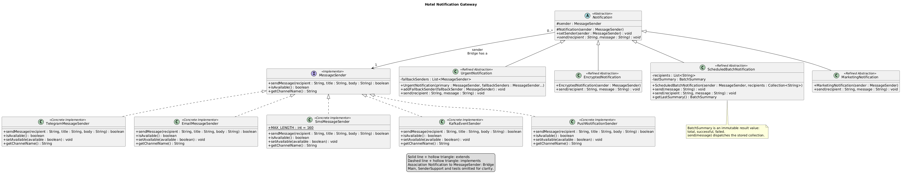

# Hotel Notification Gateway

Assignment 3 for Software Design Patterns. A Java 17 console application that uses the **Bridge pattern** to separate hotel notification behavior from message delivery channels. All deliveries are simulated; no accounts, API keys, network calls, or running Kafka server are needed by the application.

The hotel sends urgent guest alerts, encoded booking information, batch reminders, and promotional offers. The required class names and contracts from the assignment are retained.

## 1 Scenario and scope

The two independent dimensions are:

| Notification behavior | Delivery channel |
| --- | --- |
| UrgentNotification | TelegramMessageSender |
| EncryptedNotification | EmailMessageSender |
| ScheduledBatchNotification | SmsMessageSender |
| MarketingNotification | KafkaEventSender |
| | PushNotificationSender |

The rows are independent lists, not fixed notification/channel pairs. Any notification can receive any `MessageSender`; the chosen channel's delivery restrictions still apply.

Recipients such as `guest-101` are **logical guest IDs**, accepted consistently by every simulated channel. Resolving a guest ID to a real telephone number, email address, chat ID, or device token is outside this exercise.

## Build and run

Requirements: **JDK 17 or newer** and **Maven 3.6.3 or newer**. The project targets Java 17. The first Maven build needs internet access to download build plugins and JUnit. The application itself has no external runtime dependencies.

Run these commands from the directory containing `pom.xml`:

```bash
mvn clean test
mvn package
java -jar target/hotel-notification-gateway-1.0.0.jar
```

In IntelliJ IDEA, open this project's `pom.xml` as a project, select JDK 17 or newer, load the Maven project, and run `edu.hotel.gateway.Main`. Tests are in `../src` and can also be run through the Maven `test` lifecycle task.

Maven uses JUnit Jupiter **5.13.4**, the Maven Compiler Plugin **3.13.0**, Surefire **3.5.4**, and the JAR Plugin **3.4.2**. Versions are pinned in `pom.xml`.

## 2 Implementor hierarchy

The assignment's `MessageSender` contract is unchanged:

```java
public interface MessageSender {
    boolean sendMessage(String recipient, String title, String body);
    boolean isAvailable();
    String getChannelName();
}
```

`true` means the simulated provider accepted the delivery. An unavailable provider, null/blank recipient, null/blank body, or channel-specific restriction returns `false`. Failed senders do not print a successful delivery. A null title is normalized to an empty title. Each concrete sender has `setAvailable(boolean)` for the demo and defense.

| Concrete Implementor | Distinct behavior |
| --- | --- |
| TelegramMessageSender | Prints a message with a Markdown-style bold title. |
| EmailMessageSender | Prints an email subject, body, and the Hotel Guest Services signature. |
| SmsMessageSender | Sends only the body; ignores the title and rejects messages over 160 Unicode code points. No truncation. |
| KafkaEventSender | Prints a JSON event published to the simulated `hotel.notifications` topic; special characters are escaped. |
| PushNotificationSender | Prints a simulated device notification with a title and body. Added in the extension stage. |

For this educational simulation, the SMS rule is **160 Unicode code points**. It is not a model of telecom encoding or multipart SMS. The final body after notification-specific transformation is subject to the limit.

## 3 Abstraction hierarchy

`Notification` stores `protected MessageSender sender`, receives it through the protected constructor, exposes `setSender`, and declares `send(recipient, message)`. Null sender references are rejected. Subclasses refer only to the interface, never to concrete provider classes.

### UrgentNotification

Prepends `[URGENT] ` to the body and checks `isAvailable()` before delivery. The primary sender is tried first. If it is unavailable or returns `false`, fallback senders are tried in insertion order. Processing stops after the first success. If all attempts fail, a failure message is printed. Fallback delivery does not permanently replace the configured primary sender.

```java
UrgentNotification urgent = new UrgentNotification(telegram, sms);
urgent.addFallbackSender(email); // Optional additional fallback.
urgent.send("guest-101", "Your airport transfer has arrived.");
```

### EncryptedNotification

Converts the original UTF-8 message into Base64 before calling the provider. The class name follows the assignment. **Base64 is reversible encoding, not secure encryption.** It demonstrates a message transformation only.

### ScheduledBatchNotification

Stores a defensive copy of a collection of recipients, sends the same message to every recipient, and counts actual delivery results. A failure does not stop later recipients. `BatchSummary(total, successful, failed)` stores the result of the latest dispatch.

```java
ScheduledBatchNotification batch = new ScheduledBatchNotification(
        sms, List.of("guest-101", "guest-102", "guest-103"));
batch.send("Reminder: checkout is at 12:00.");
BatchSummary summary = batch.getLastSummary();
```

There are two intentional overloads:

| Method | Recipients used |
| --- | --- |
| `send(message)` | All recipients stored in the constructor. |
| `send(recipient, message)` | Only the explicit recipient; honors the base `Notification` contract. |

The collection may be empty, in which case the summary is `0 / 0 / 0`. Null collections and null elements are rejected at construction. Blank IDs are retained and rejected by the provider, so they are counted as failed deliveries.

The assignment's mandatory batch behavior is a collection, delivery, and a summary. This version is **caller-triggered**: `Main` invokes the batch when it should run. It does not contain a real clock-based scheduler, background worker, or persistence.

### MarketingNotification

Adds an offer label and opt-out instructions before sending. It extends `Notification` and uses the existing `MessageSender` interface. It was added during the independent extension stage.

## 4 Runtime provider switching

```java
Notification notification = new UrgentNotification(telegram, sms);
notification.send("guest-101", "Please contact the front desk.");
notification.setSender(email);
notification.send("guest-101", "Please contact the front desk.");
```

The same `notification` object is used for both calls. Its notification behavior is unchanged; only the `sender` reference is replaced. No notification source code is changed to switch channels.

## 5 Fallback mechanism

```java
telegram.setAvailable(false);
new UrgentNotification(telegram, sms)
        .send("guest-101", "Your airport transfer has arrived.");
```

The abstraction asks each candidate `isAvailable()` and calls `sendMessage(...)` through `MessageSender`. It does not use `instanceof`, reflection, concrete provider imports, or a switch on provider names. `getChannelName()` is used only for readable output.

## 6 Independent extension

The initial implementation consists of the three required refined abstractions and four required concrete providers. It is compiled and tested before the extension stage. Two new production classes are then added:

- `sender/PushNotificationSender.java` implements `MessageSender`.
- `notification/MarketingNotification.java` extends `Notification`.

Adding a provider changes only the implementation dimension. Adding a notification type changes only the abstraction dimension. A new class can immediately collaborate with the opposite hierarchy through the existing interface. This is the main advantage of Bridge.

## 7 Mandatory demo

`Main.main()` runs the following sections in order:

| Section | Demonstration | Result to observe |
| --- | --- | --- |
| 1 | UrgentNotification + Telegram | Bold title, `[URGENT]` body, successful Telegram delivery. |
| 2 | EncryptedNotification + Email | Encoded Base64 body, email subject, hotel signature. |
| 3 | ScheduledBatchNotification + SMS | Ten entries: eight valid IDs and two intentionally blank IDs. Summary `Total: 10`, `Successful: 8`, `Failed: 2`. |
| 4 | Runtime switching Telegram to Email | Same notification object, same text, different delivery formatting. |
| 5 | Telegram unavailable, fallback to SMS | Telegram is skipped and SMS accepts the urgent message. |
| 6 | MarketingNotification + PushNotificationSender | New notification behavior works with the new provider. |
| 7 | Extra Kafka demonstration | A simulated JSON event is published to `hotel.notifications`. |
| 8 | Extra SMS failure | A body over the configured SMS limit returns `false`. |
| 9 | Extra complete delivery failure | Both primary and fallback are unavailable; no false success is reported. |

No separate classes for notification/provider combinations are created.

## 8 Unit tests

**Verified result: 30 tests, 0 failures, 0 errors, 0 skipped.** Tests use **JUnit 5** and cover successful delivery, unavailable providers, fallback, the SMS boundary and rejection, Unicode counting, Base64 transformation, batch counts and iteration, runtime switching, Push, Marketing, and failure cases.

The sender tests capture a constructor-injected `PrintStream`, so they can inspect provider output without changing global `System.out`. Notification tests use a small `RecordingSender` test double implementing `MessageSender` to inspect which provider received what and how often. Extension tests verify compatibility with the existing opposite hierarchy. No real service is called.

## 9 UML and required design answers



The editable diagram is [docs/uml.png](docs/uml.png). The diagram identifies all four Bridge roles and the `Notification` to `MessageSender` association. Small helpers, test doubles, and the client `Main` are omitted from the pattern-focused class diagram; `BatchSummary` is a result value used by the batch class.

### What are the two independent dimensions

Notification behavior (urgent, encoded, batch, marketing) and message delivery mechanism (Telegram, email, SMS, Kafka, push).

### Where exactly is the Bridge

The `protected MessageSender sender` field inside `Notification` is the reference connecting the two hierarchies. Notifications delegate actual delivery through `sender.sendMessage(...)`. The constructor injects the initial implementation and `setSender(...)` can replace it at runtime.

### Why is inheritance problematic here

If notification behavior and delivery details were combined in one class hierarchy, classes such as `UrgentTelegramNotification` and `UrgentEmailNotification` would repeat behavior across combinations. With N notification types and M channels, this approach can require N times M combination classes. Bridge uses N refined abstractions plus M concrete implementors, in addition to the shared base abstraction and interface. Inheritance still exists within each hierarchy; composition connects the two independent dimensions.

### What happens when a new provider is added

Create one class implementing `MessageSender`, and select an instance in the client code. Existing notification classes do not need modification. New tests cover the provider and its compatibility.

### What happens when a new Notification type is added

Create one subclass of `Notification`, implement its message behavior, and delegate delivery through the inherited `sender`. Existing provider classes do not need modification.

### Why is this Bridge rather than Adapter

The design deliberately separates two dimensions that should evolve independently. There is no pre-existing incompatible service API being wrapped to fit another interface. Adapter's purpose is to reconcile incompatible interfaces; this project's purpose is independent variation of abstraction and implementation.

## 10 Individual defense

Be ready to explain the diagram, trace a send call, demonstrate all six mandatory scenarios, and modify the program. Contains an English defense script and concrete practice changes: WhatsApp, a 120-character SMS limit, SilentNotification, unavailable email, an additional fallback, and runtime switching.

Read the code before submitting. A successful run demonstrates behavior; the individual defense also requires explaining and modifying it.

## Project map

| Location | Purpose |
| --- | --- |
| `pom.xml` | Maven build, Java release, JUnit dependency, runnable JAR entry point. |
| `src` | Demo and object creation. |
| `src` | Abstraction, refined abstractions, and batch summary value. |
| `src` | Implementor interface, concrete senders, small formatting helper. |
| `src` | JUnit tests and test double. |
| `docs` | UML, Russian guides, demo output, verification evidence. |

## References

- Assignment 3 — Multi-Channel Notification Gateway, supplied course assignment: required Java contracts, scenarios, tests, UML questions, and defense tasks.
- [JUnit 5.13.4 User Guide](https://docs.junit.org/5.13.4/user-guide/index.html): JUnit Jupiter tests and Maven integration.
- [Maven Compiler Plugin release setting](https://maven.apache.org/plugins/maven-compiler-plugin/examples/set-compiler-release.html): compilation targeting Java 17.
- [Java 17 Base64 API](https://docs.oracle.com/en/java/javase/17/docs/api/java.base/java/util/Base64.html): standard Base64 encoder and decoder.
